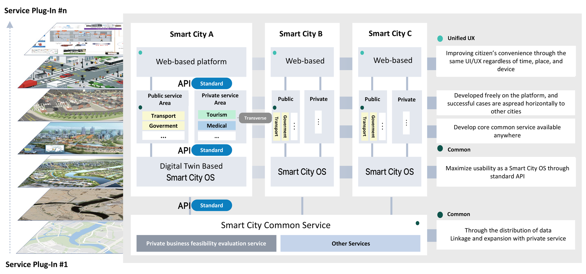
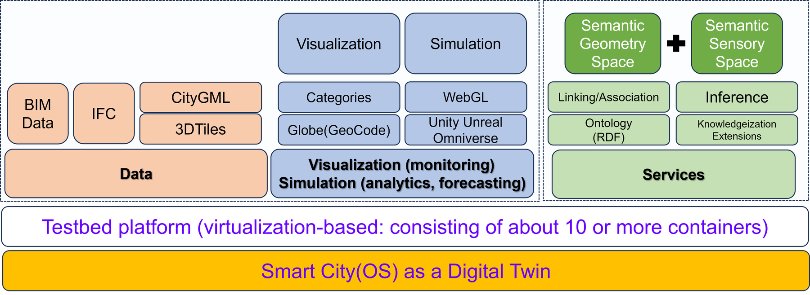
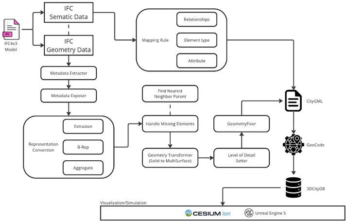
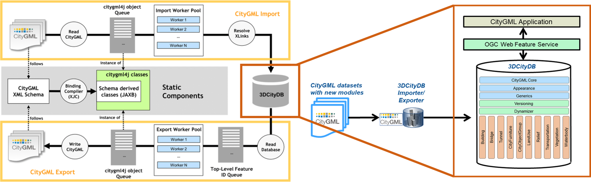
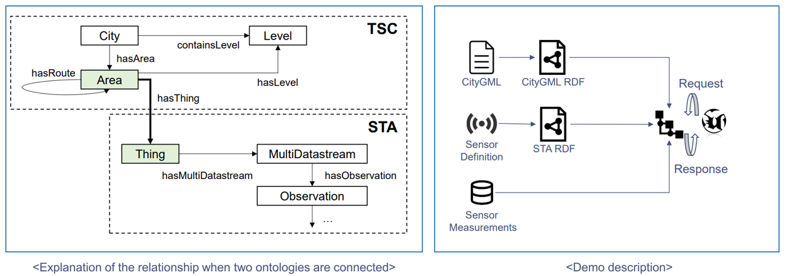
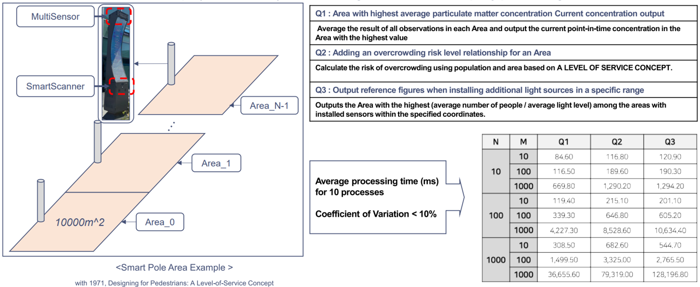
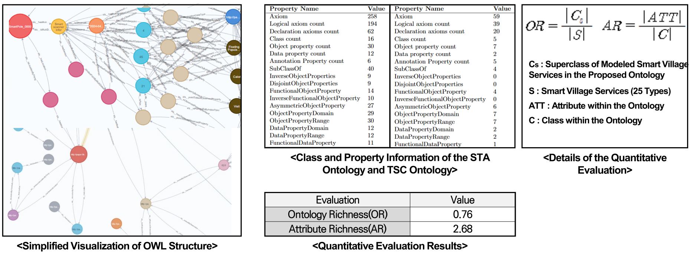

## Smart City project

  <iframe src="https://www.youtube-nocookie.com/embed/HJqI0qVst9k" title="Digital Twin for Smart City — project video" loading="lazy" allow="accelerometer; encrypted-media; gyroscope; picture-in-picture" allowfullscreen></iframe>

## Service platform

- The layered plug-in service platform for smart cities fosters innovation by allowing diverse cities to build and share services across public and private sectors. A standard API connects digital-twin-based Smart City Operating Systems across multiple cities, integrating transport, government, medical, tourism and other services. Through a unified UX, citizens get consistent, accessible services regardless of location or device.
- The platform's modularity lets cities develop and test new solutions that scale horizontally to other smart cities. This standardized framework maximizes the usability of core services, supports data linkage and expands private services while keeping a common platform across all cities.
- The result is an efficient ecosystem in which successful innovations can be rapidly deployed across urban environments.

<figure>
  
  <figcaption>Creating innovative cases of various smart cities based on a layered plug-in service platform.</figcaption>
</figure>

<figure>
  
  <figcaption>Building a digital twin testbed to demonstrate Smart City Lab-based services.</figcaption>
</figure>

## City data management

- The City Database Management solution, based on **3DCityDB**, imports CityGML data by reading XML schemas, converting them into schema-derived classes and storing them in a structured database.
- An import worker pool resolves XLinks, processing CityGML objects into the database for efficient storage and retrieval.
- Once in 3DCityDB, data is served through the OGC Web Feature Service, so city applications can retrieve, display and manipulate 3D buildings, bridges and transportation networks.

<figure>
  
  <figcaption>3D city data — conversion methodology.</figcaption>
</figure>

<figure>
  
  <figcaption>3D city data — city database management solution.</figcaption>
</figure>

## Open-standard IoT ontology

- CityGML spatial data and **SensorThings API** (STA) sensor data are semantically linked through RDF.
- Connecting city areas, levels and routes with sensor observations and datastreams enables bidirectional request–response interactions for richer urban analysis and visualization.

<figure>
  
  <figcaption>Ontology integration of CityGML and SensorThings API for semantic interoperability.</figcaption>
</figure>

- Multi-sensors and smart scanners on smart poles collect environmental and population data across subdivided areas. The system identifies particulate hotspots, assesses overcrowding risk and evaluates reference figures for optimized lighting installations.

<figure>
  
  <figcaption>Smart-pole area example with sensor-based data processing and overcrowding risk analysis.</figcaption>
</figure>

- The new digital twin ontology based on OGC SensorThings API was evaluated quantitatively.

<figure>
  
  <figcaption>Ontology visualization and quantitative evaluation of STA and TSC ontologies.</figcaption>
</figure>

## Acknowledgement

This work was supported by the Institute for Information & Communications Technology Promotion (IITP) grant funded by the Korea government (MSIP) (No. 2022-0-00622, Digital Twin Testbed Establishment).
