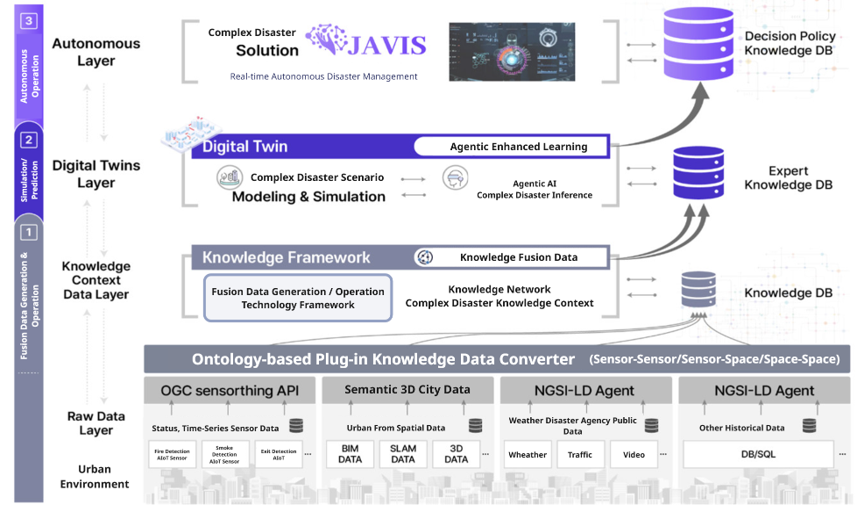
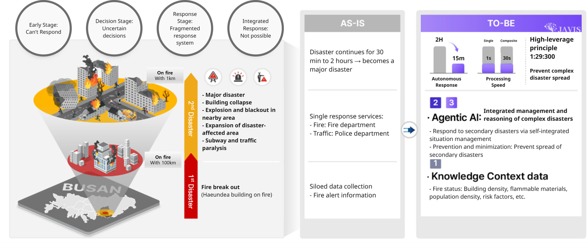
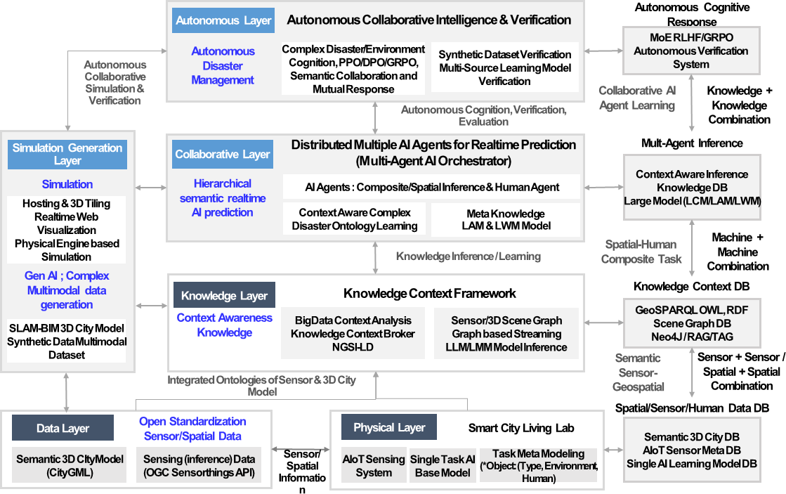

## Overview

JAVIS is our long-term project under the **Digital Columbus Project** (disaster-safety track) of the Ministry of Science and ICT. Over eight years (2025 – 2032), we are developing an **agentic AI – digital twin platform** that predicts, prevents and responds to complex disasters — for example, a building fire that cascades into secondary catastrophes across a city.

Instead of fragmented, siloed responses, JAVIS coordinates multiple AI agents on top of a live digital twin of the city, so that hazards can be detected early, their impact simulated, and response actions recommended in real time. The platform targets smart cities, industrial complexes and coastal cities.

JAVIS는 과학기술정보통신부 '디지털 콜럼버스 프로젝트' 재난안전 분야의 장기 과제입니다. 2025년부터 2032년까지 8년간, 화재가 도시 전역의 2차 재난으로 확산되는 것과 같은 **복합재난을 예측·예방·대응하는 에이전틱 AI – 디지털 트윈 플랫폼**을 개발합니다.

분절된 대응 대신, 도시의 실시간 디지털 트윈 위에서 여러 AI 에이전트가 협력하여 위험을 조기에 감지하고, 영향을 시뮬레이션하며, 대응 조치를 실시간으로 제안합니다. 스마트시티, 산업단지, 해안 복합도시를 대상으로 합니다.

## Agentic AI – digital twin platform

<figure>
  
  <figcaption>Complex Disaster Management System — JAVIS (Joint Autonomous Resilience Virtual Intelligent System)</figcaption>
</figure>

<figure>
  
  <figcaption>From fragmented response to AI-driven disaster management: preventing secondary catastrophes in urban fires</figcaption>
</figure>

<figure>
  
  <figcaption>Multi-layered AI framework for real-time disaster prediction and smart-city resilience</figcaption>
</figure>

## Materials

  <a href="/researches/2025%20Digital%20Columbus%20Project%20-%20JAVIS%20-%20ENG.pdf" target="_blank" rel="noopener">2025 Digital Columbus Project — JAVIS (English)</a>
  <a href="/researches/2025%20Digital%20Columbus%20Project%20-%20JAVIS%20-%20KOR.pdf" target="_blank" rel="noopener">2025 디지털 콜럼버스 프로젝트 — JAVIS (한국어)</a>

## Acknowledgement

This work was supported by the Institute of Information & Communications Technology Planning & Evaluation (IITP) grant funded by the Korea government (MSIT).
